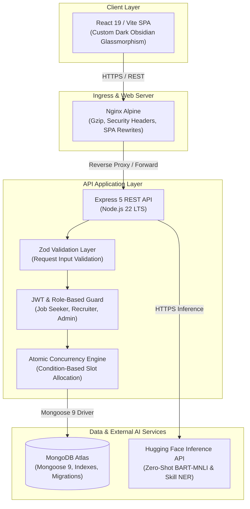

# Nexus — Full-Stack MERN AI Career Platform

[](https://nexus-web-lzfk.onrender.com)
[](https://nexus-api-ullk.onrender.com/api/v1/docs)
[](https://github.com/ziad7000/nexus/actions/workflows/ci.yml)
[](https://www.mongodb.com/mern-stack)
[](https://huggingface.co/)
[](https://nodejs.org/)
[](https://expressjs.com/)
[](https://react.dev/)
[](https://www.docker.com/)
[](LICENSE)

**Nexus** is a production-grade **MERN** career and hiring platform integrated with **Hugging Face AI** for intelligent candidate-job matching, automated skill extraction from developer bios, and zero-shot taxonomy classification.

Built for high concurrency and cloud-native reliability, Nexus implements **atomic database concurrency controls** to guarantee zero-oversubscription during high-velocity application bursts, stateless JWT authentication with role-based access control, multi-stage Docker containerization, and continuous deployment via GitHub Actions to Render Cloud PaaS.

---

## Live Deployments & Quick Links
- **Live Web Application:** [https://nexus-web-lzfk.onrender.com](https://nexus-web-lzfk.onrender.com)
- **Interactive Swagger UI (Cloud):** [https://nexus-api-ullk.onrender.com/api/v1/docs](https://nexus-api-ullk.onrender.com/api/v1/docs)
- **Live Cloud Health Telemetry:** [https://nexus-api-ullk.onrender.com/health](https://nexus-api-ullk.onrender.com/health)
- **Architecture Decision Records:** [docs/DECISIONS.md](docs/DECISIONS.md)
- **REST Client Collection:** [requests/](requests/)

---

## System Architecture



---

## Key Technical Highlights

### 1. Hugging Face AI Integration & Skill Matching
- **Zero-Shot Job Classification (`facebook/bart-large-mnli`):** Analyzes job descriptions in real-time to tag them into engineering domains (Backend, Frontend, AI/ML, DevOps, Data Engineering) with automated keyword fallback heuristics.
- **NLP Bio Skill Extraction:** Parses unstructured candidate bios to automatically extract technical competencies (React, Node.js, Docker, Kubernetes, PyTorch, MongoDB, Redis, etc.).
- **Cosine Similarity Recommendation Engine:** Calculates vector overlap between candidate skills and job requirements to generate real-time AI-recommended opportunities.
- **Cover Letter Generation:** Leverages AI text generation to draft tailored, role-specific cover letters directly from candidate profiles.

### 2. Atomic Concurrency Control (Zero Oversubscription)
- **The Challenge:** When an in-demand job post has limited vacancies (e.g. 5 open positions), concurrent submissions by dozens of candidates cause race conditions, resulting in oversubscription.
- **The Solution:** Rather than relying on naive read-modify-write patterns, Nexus leverages condition-based atomic decrements directly in the database engine:
  ```javascript
  const updatedJob = await JobPost.findOneAndUpdate(
    { _id: jobId, status: 'open', remainingSlots: { $gt: 0 } },
    { $inc: { remainingSlots: -1 } },
    { returnDocument: 'after' }
  );
  ```
  If application processing fails downstream, an automated compensation rollback restores the slot.
- **Multi-Threaded Proof Test:** Verified via an automated concurrent stress test ([applicationSlotRace.test.js](backend/tests/concurrency/applicationSlotRace.test.js)). When 25 candidates submit parallel applications for 5 slots:
  - Exactly **5 requests succeed** (`HTTP 201 Created`).
  - Exactly **20 requests are safely rejected** (`HTTP 409 Conflict: SLOT_EXHAUSTED`).
  - Database `remainingSlots` ends up at exactly `0`.

### 3. Production MERN Stack Hardening
- **Decoupled Architecture:** Express `app.js` is completely decoupled from `server.js`, enabling sub-second in-memory integration testing via Supertest without binding network ports.
- **Automated Database Migrations (`migrate-mongo`):** Version-controlled schema migrations (`backend/migrations/`) executed automatically in CI and production before server boot, provisioning unique compound indexes (e.g. `user + job` uniqueness).
- **Stateless JWT & Role-Based Access Control:** Secure authentication with distinct privilege tiers for Job Seekers, Recruiters, and System Administrators.

### 4. Production Containerization & CI/CD
- **Multi-Stage Dockerfiles:** Built on `node:22-alpine` and `nginx:1.27-alpine` with minimal attack surface, dropping root privileges to execute as unprivileged `USER node`.
- **One-Command Orchestration:** `docker compose up --build` launches MongoDB with healthchecks, the hardened API, and the production frontend web server.
- **GitHub Actions CI:** Complete automation pipeline running full builds, database migrations, unit tests, and the multi-threaded race condition proof test against a live MongoDB container.
- **One-Command Orchestration:** `docker compose up --build` launches MongoDB with healthcheck, the hardened API, and the optimized frontend web server.
- **GitHub Actions CI:** Complete automation pipeline running full builds, database migrations, unit tests, and the multi-threaded race condition proof test against a real MongoDB service container.

---

## Quickstart Guide

### Option A: 1-Command Startup (Docker Compose)
Prerequisite: Docker & Docker Compose installed.

```bash
# Clone the repository
git clone https://github.com/ziad7000/nexus.git
cd nexus

# Copy environment template
cp .env.example .env

# Launch all services
docker compose up --build
```
- Frontend Web App: `http://localhost:3000`
- REST API Server: `http://localhost:5000`
- Swagger UI Documentation: `http://localhost:5000/api/v1/docs`
- Healthcheck Endpoint: `http://localhost:5000/health`

---

### Option B: Local Development Workflow

#### 1. Backend Setup
```bash
cd backend
cp .env.example .env
npm install

# Run database migrations
npm run migrate:up

# Execute test suite (including concurrency proof test)
npm test

# Start API in dev mode with live reload
npm run dev
```

#### 2. Frontend Setup
```bash
cd client
npm install
npm run dev
```
Visit `http://localhost:5173` in your browser.

---

## Automated Test Verification

Execute all automated unit, integration, and concurrency stress tests:
```bash
cd backend
npm test
```

Execute specifically the concurrency race condition test:
```bash
cd backend
npm run test:concurrency
```

---

## Declarative Cloud Deployment (Render Blueprint)

The repository includes a battle-tested [`render.yaml`](render.yaml) blueprint:
1. Connect your GitHub repository to [Render](https://render.com).
2. Select **Blueprints** -> New Blueprint Instance.
3. Render automatically provisions:
   - `nexus-api`: Web service running on Node 22, executing migrations before launch with a continuous `/health` check.
   - `nexus-web`: High-performance static web server with client-side SPA routing rewrites and automatic backend URL binding.

---

## Author & License

- **Author:** [Ziad Islam](https://github.com/ziad7000)
- **License:** [MIT License](LICENSE)
