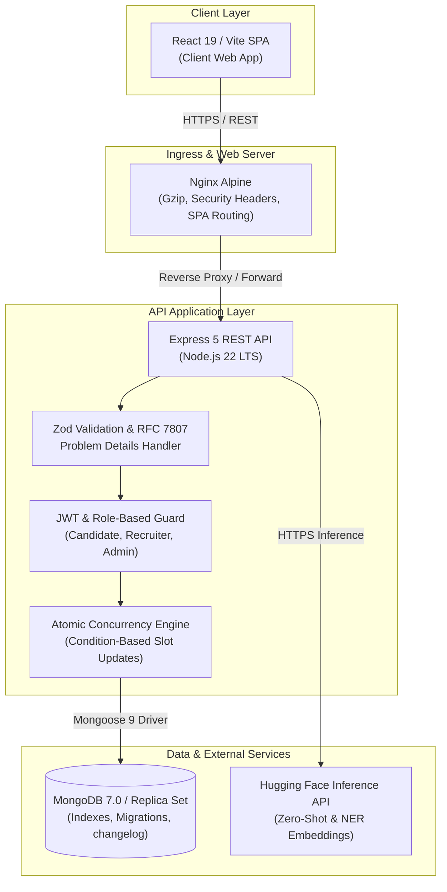

# GIU Nexus — Production-Grade AI Career Platform

[](https://github.com/ziad7000/giu-nexus/actions/workflows/ci.yml)
[](https://nodejs.org/)
[](https://expressjs.com/)
[](https://react.dev/)
[](https://vitejs.dev/)
[](https://www.mongodb.com/)
[](https://www.docker.com/)
[](LICENSE)

GIU Nexus is a production-hardened university career and recruitment platform engineered by **Ziad Islam**. It connects students with high-impact job opportunities using AI-powered semantic matching, automated NER skill extraction from candidate bios, and zero-shot category classification.

The platform is built to modern cloud-native standards, featuring **atomic concurrency control** for limited job vacancies, **RFC 7807 problem details** error handling, **version-controlled database migrations**, **multi-stage Docker containerization**, **GitHub Actions CI/CD**, and **declarative cloud infrastructure**.

---

## Quick Links
- **Interactive Swagger UI:** [`http://localhost:5000/api/v1/docs`](http://localhost:5000/api/v1/docs) *(or cloud instance)*
- **API Health Check:** [`http://localhost:5000/health`](http://localhost:5000/health)
- **Architecture Decision Records:** [docs/DECISIONS.md](file:///Users/ziad/Desktop/giu-nexus/docs/DECISIONS.md)
- **REST Client Collection:** [requests/](file:///Users/ziad/Desktop/giu-nexus/requests/)

---

## System Architecture



---

## Key Engineering Differentiators

### 1. Atomic Condition-Based Concurrency Control
- **The Challenge:** When an in-demand job post has limited vacancies (e.g. 5 open positions), concurrent submissions by dozens of candidates cause race conditions, resulting in oversubscription.
- **The Solution:** Rather than relying on naive read-modify-write patterns, the application leverages atomic condition-based updates directly in the database engine:
  ```javascript
  const updatedJob = await JobPost.findOneAndUpdate(
    { _id: jobId, status: 'open', remainingSlots: { $gt: 0 } },
    { $inc: { remainingSlots: -1 } },
    { returnDocument: 'after' }
  );
  ```
  If application creation fails downstream, an automated rollback restores the slot.
- **Proof Test:** Verified via an automated multi-threaded stress test ([applicationSlotRace.test.js](file:///Users/ziad/Desktop/giu-nexus/backend/tests/concurrency/applicationSlotRace.test.js)). When 25 candidates submit parallel applications for 5 slots:
  - Exactly **5 requests succeed** (`HTTP 201 Created`).
  - Exactly **20 requests are rejected** with RFC 7807 problem details (`HTTP 409 Conflict: SLOT_EXHAUSTED`).
  - Final database `remainingSlots` ends up at exactly `0`.

### 2. RFC 7807 Standardized Problem Details
All API errors return standardized `application/problem+json` envelopes:
```json
{
  "type": "https://api.giu-nexus.com/errors/slot-exhausted",
  "title": "Conflict",
  "status": 409,
  "detail": "All available slots for this position have been filled.",
  "instance": "/api/v1/jobs/65fa3.../apply",
  "code": "SLOT_EXHAUSTED",
  "timestamp": "2026-11-19T18:50:00.000Z"
}
```

### 3. Version-Controlled Automated Migrations (`migrate-mongo`)
Eliminated manual SQL/NoSQL scripting. Migrations define reproducible database indexes and schema backfills versioned in source control (`backend/migrations/`) executed automatically in CI and container entrypoints.

### 4. Production Containerization & CI/CD
- **Multi-Stage Dockerfiles:** Built on `node:22-alpine` and `nginx:1.27-alpine`. Non-root unprivileged execution (`USER node`).
- **One-Command Orchestration:** `docker compose up --build` launches MongoDB with healthcheck, the hardened API, and the optimized frontend web server.
- **GitHub Actions CI:** Complete automation pipeline running full builds, database migrations, unit tests, and the multi-threaded race condition proof test against a real MongoDB service container.

---

## Quickstart Guide

### Option A: 1-Command Startup (Docker Compose)
Prerequisite: Docker & Docker Compose installed.

```bash
# Clone the repository
git clone https://github.com/ziad7000/giu-nexus.git
cd giu-nexus

# Copy environment template
cp .env.example .env

# Launch all services
docker compose up --build
```
- Frontend Web App: `http://localhost:3000`
- REST API Server: `http://localhost:5000`
- Swagger UI Documentation: `http://localhost:5000/api/v1/docs`
- Healthcheck Endpoint: `http://localhost:5000/health`

---

### Option B: Local Development Workflow

#### 1. Backend Setup
```bash
cd backend
cp .env.example .env
npm install

# Run database migrations
npm run migrate:up

# Execute test suite (including concurrency proof test)
npm test

# Start API in dev mode with live reload
npm run dev
```

#### 2. Frontend Setup
```bash
cd client
npm install
npm run dev
```
Visit `http://localhost:5173` in your browser.

---

## Automated Test Verification

Execute all automated unit, integration, and concurrency stress tests:
```bash
cd backend
npm test
```

Execute specifically the concurrency race condition test:
```bash
cd backend
npm run test:concurrency
```

---

## Declarative Cloud Deployment (Render Blueprint)

The repository includes a battle-tested [`render.yaml`](file:///Users/ziad/Desktop/giu-nexus/render.yaml) blueprint:
1. Connect your GitHub repository to [Render](https://render.com).
2. Select **Blueprints** -> New Blueprint Instance.
3. Render automatically provisions:
   - `giu-nexus-api`: Web service running on Node 22, executing migrations before launch with a continuous `/health` check.
   - `giu-nexus-web`: High-performance static web server with client-side SPA routing rewrites and automatic backend URL binding.

---

## Author & License

- **Author:** [Ziad Islam](https://github.com/ziad7000)
- **License:** [MIT License](LICENSE)
